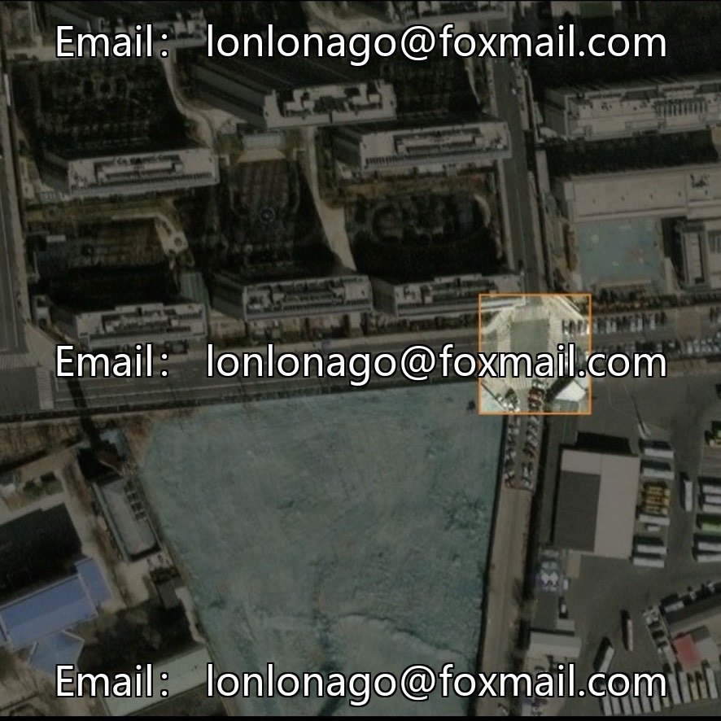
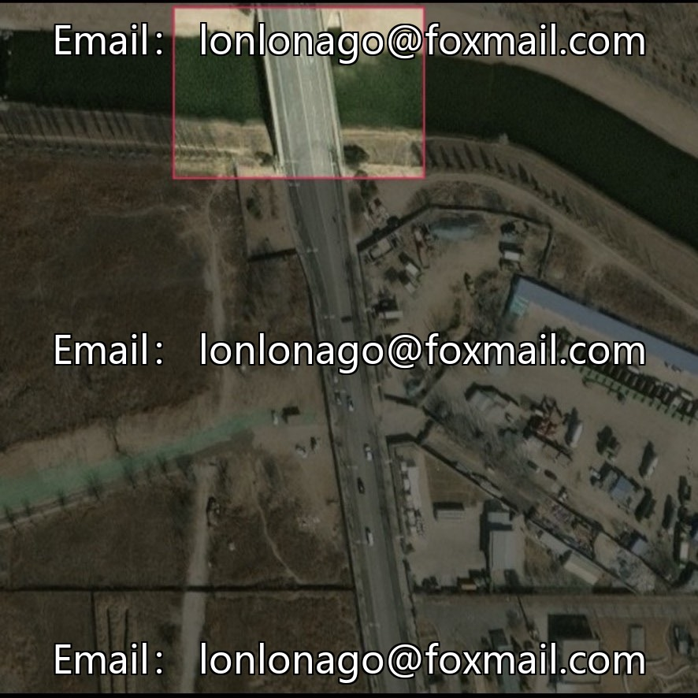
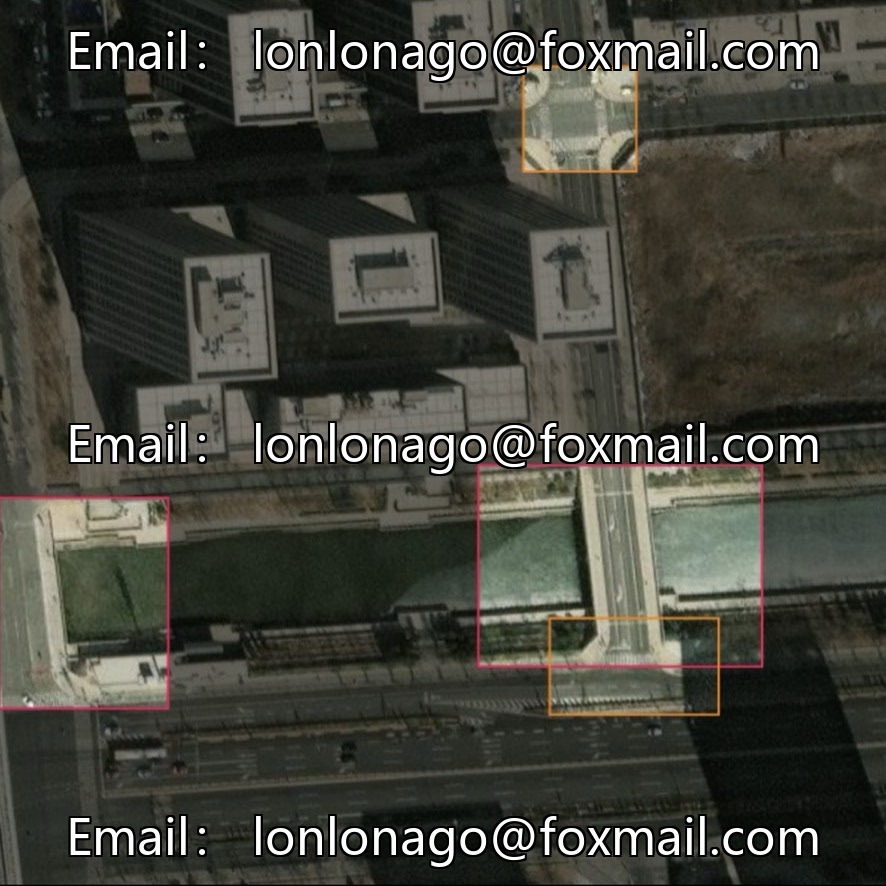
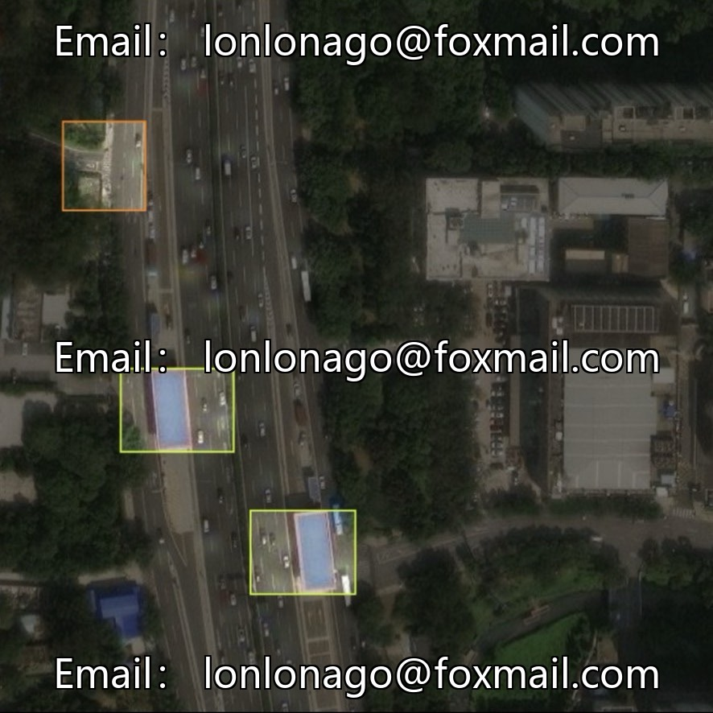
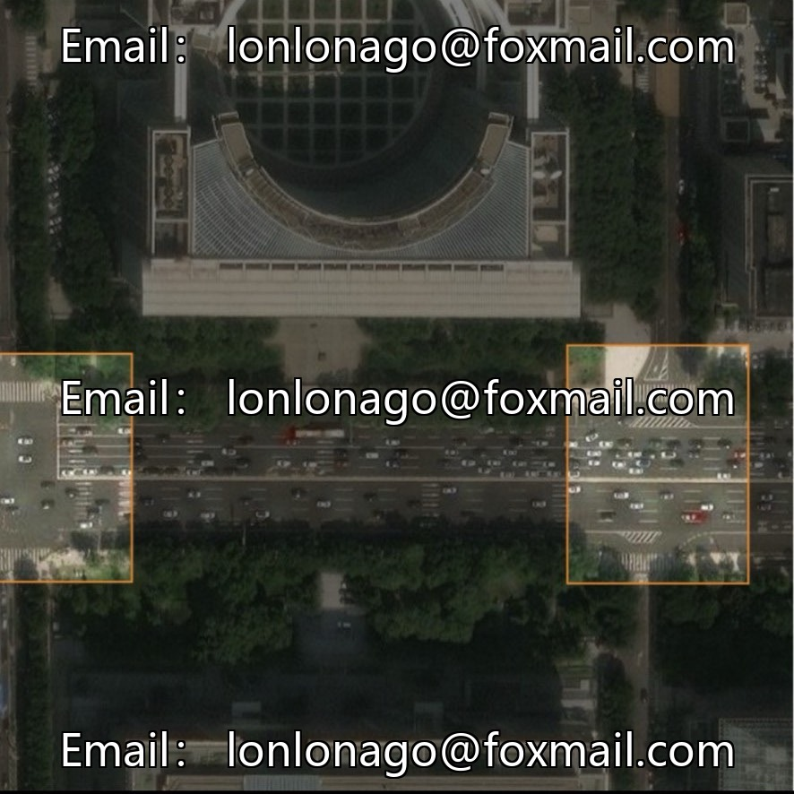
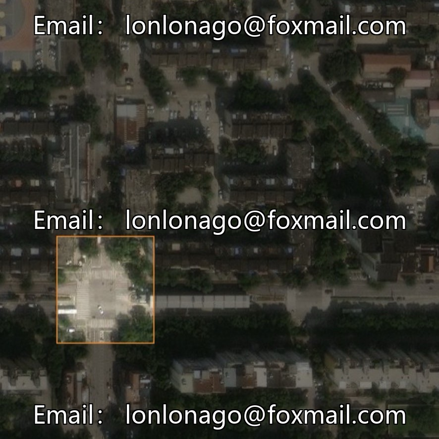

# High-speed road network aerial photography dataset for detecting crossroads and toll stations | Issue 1075

## Body

High-speed Road Network Aerial Photography Data Set | Issue 1075
Designed specifically for drone aerial photography of high-speed road networks, this dataset comes with complete YOLOv8 training and inference code, suitable for highway remote sensing mapping and intelligent inspection.

Basic Information
- Sample Size: 903 aerial high-altitude real scene images, covering complete high-speed scenarios such as interchanges, tunnels, toll stations, etc., and discarding blurry or severely obstructed invalid samples.
- Label compatibility with three mainstream formats: YOLO, VOC, COCO, no need for conversion during training.
- Six class label targets: Bridge, Bridge entrance, Lantun rack, High-speed toll station, Road intersection, Tunnel entrance

Comprehensive training code
Based on the YOLOv8 lightweight model, adaptable for high-altitude aerial view small structures recognition
- Training parameters: Iterated 26 times, input size 640, batch=6, GPU training, early stopping to prevent overfitting
- Includes dataset yaml configuration template, single image inference code, and outputs detection box visualization results after running

Scene and landing advantages
The sample includes typical complex scenes such as aerial photography, building obstruction, and large-area roads.
Deployable mapping drones, road network monitoring, and land planning terminals, automatically count the number of various types of transportation structures, supporting digital surveying of infrastructure and road maintenance planning.

Virtual materials, once sold, are non-refundable.
Interested friends, click "I want" to proceed.

## Images

## Payment

Here is a pay link on Stripe ( https://buy.stripe.com/3cs8yP7sY87d0vu9AB ). Please contact me lonlonago@foxmail.com after funding $89, and I will send you a complete data files , thank you!

